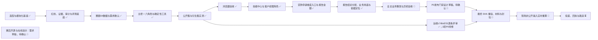
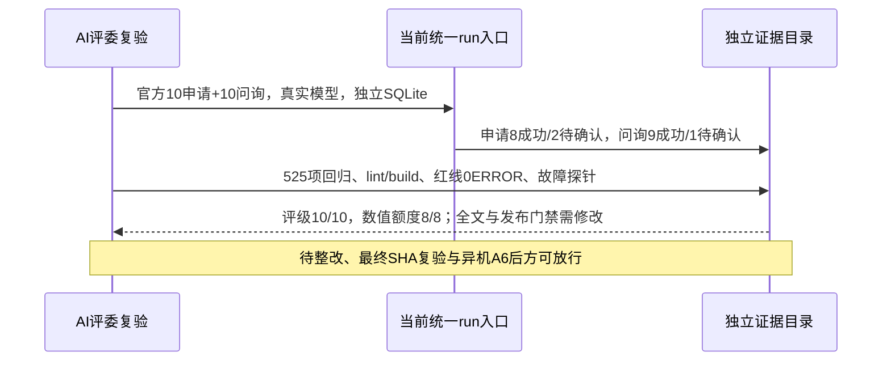
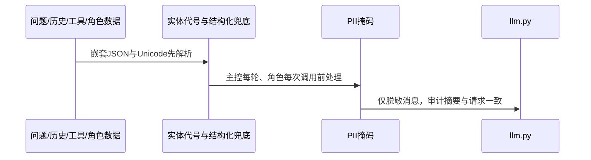

# 项目开发流程

> 活文档：记录当前阶段和放行门禁；实际发生的过程与旧指标只追加到 [开发日志](开发日志.md)，技术决策见 [ADR](../20-architecture/adr/README.md)。
> 状态：✅ 已完成 / 🔄 进行中 / ⏳ 未开始。最近更新：2026-10-25。

## 当前流程



核心答题链路：

```text
POST /api/agent/runs
  → 输入合规与对象定位
  → LangGraph 主控调用 run_dd_agents
  → 五角色确定性计算按依赖顺序完成
  → business / finance / opinion / fraud / rating 并行解读
  → report 汇总 → 发布前事实校验
  → 证据、轨迹、审计落库
  → 输出合规
  → succeeded / needs_confirmation / needs_clarification /
    insufficient_evidence / blocked / failed
```

## 状态表

| # | 阶段 | 状态 | 当前产出与边界 |
|---|------|------|----------------|
| 1 | 技术选型与代码分层 | ✅ | Python/FastAPI、React/TS/Vite；`routers → services → agent/tools/compliance → domain`；见 ADR-0001、ADR-0004 |
| 2 | Agent 基座 | ✅ | 模型锁定、统一 run、工具注册、证据、审计、确认、六种终态、异步 SSE |
| 3 | 安全与红线 | ✅ 基础能力 | 运行时标签隔离、PII/名称处理、附件同步拒绝、输入输出合规；最终产物仍须逐项复扫 |
| 3a | J01/J02 发布门禁整改 | 🔄 设计草稿 | 无证据拒发、具体法规引用拒发；待设计确认与实施验证，尚未关闭P0 |
| 3b | origin/main固定SHA独立逐条评审 | ✅ 评审 / 🔄 整改 | c7dbd231：35/48自定义条款分；3项P0防线缺口；20条真实运行、570回归。见[逐条报告](../../测试数据/评测/2026-10-25/AI评委逐条评分-origin-main-20261025.md)，不代表本地设计已实施或最终放行 |
| 4 | 一键启动与离线依赖 | ✅ 本机预演 / 🔄 异机验收 | 包内 Python、wheel、dist 和 `start.bat` 已完成本机空目录预演；异机 A6 真断网与云服务白名单待验 |
| 5 | 通用评测框架 | ✅ | JSONL/JSON/CSV/XLSX、断点续跑、泄漏检查、通用导出；赛题04另有六列专用导出 |
| 6 | 赛题04数据与工具 | ✅ | 九类业务事实、数据体检、增量导入、工商/财务/舆情/反欺诈/评级/额度/报告工具 |
| 7 | 赛题04多 Agent | ✅ | 主控 + 六角色、确定性工具计算、模型解读、报告汇总、运行时 Skill 与事实校验已实现 |
| 8 | 前端工作台与系统管理 | ✅ 主要实现 | 登录权限、客户经理角色、企业档案、尽调步骤、角色泳道、Agent Skill 技能中心、证据、贷款申请四态审核、报告导出、尽调报告检索与轨迹已实现；报告本身无状态 |
| 9 | A5 浏览器走查 | ✅ | 七项功能已逐项走查，M4 四张脱敏截图已生成；最终冻结 SHA 如界面或结果变化须重拍 |
| 10 | 业务评测 | 🔄 | `dd04-business-acceptance`：申请 8成功/2待确认/0失败，问询9成功/1待确认，评级10/10，8个数值额度8/8，506项测试通过；**全文业务验收未通过** |
| 11 | 历史输出 | ✅ 已归档 | `00e905f` 只作归档输出，不代表当前代码或最终验收结论 |
| 12 | 正式材料 | 🔄 | 技术方案 PDF、测试报告 PDF、M9 样例、manifest/XLSX、第三方声明和封包脚本均已生成；现有版本绑定旧 SHA |
| 13 | 最终验证与封包 | 🔄 | `f9594d9` / `d70ba07` 后尚未完成同一冻结 SHA 的复核、重出、重验与重包 |
| 14 | 官方非公开集 | 🔄 | 2026-10-25 已用官方输入实时重算 20 笔（14 成功/5 待确认/1 失败），见[非公开测评报告](../../测试数据/评测/2026-10-25/6e97cb3-官方非公开集/非公开测评报告.md)；冻结 SHA 上须重跑 |
| 15 | 投递与路演 | ⏳ | 六位成员联系方式已补齐；视频与组委会回执待核对 |
| 16 | 贷款申请维度入口 | ✅ | 按申请编号绑定六步与报告；增加申请贷款额度；工作台仅保留审批表；564 项后端与 2 项前端路由测试通过，真实抽测 1 笔成功；未做本轮视觉验收 |
| 17 | 尽调五步菜单术语统一 | ✅ | 菜单改为「财报解析 → 工商核验 → 舆情扫描 → 反欺诈检测 → 额度测算」并按此重排；路由 slug、API step、工具映射与编排不变；官方报告章节名「财务分析」保留；lint/build/前端测试与单步 API 测试通过 |

| 18 | 报告结论分层、业务用语与依据定位 | ✅ | 用户指定优化项 2/3/4 完成，后按指示移除 HTML 首页三状态卡与末页证据附录；570 项后端、13 项前端测试与针对性模型复测记录见规格；浏览器视觉与官方全量门禁另行验收 |

| 19 | 赛后开源与在线演示 | 🔄 需求草稿 | [需求](../40-specs/open-source-demo/requirements.md)：自建自有凭据，线上维护者专用 Key；尚未改配置、清理历史、公开仓库或部署 |

## 当前放行门禁

1. 修复并复核 `dd04-business-acceptance` 的全文解释错误、覆盖缺项与参考冲突；506 项测试通过不等于全文业务验收通过。
2. 在另一台干净 Windows 机器完成 A6：真断网依赖安装、`start.bat`、页面、批量链路及模型 API、云 MySQL/Redis 白名单验收。
3. 在最终冻结 SHA 上统一执行后端测试、前端 lint/build、红线扫描、六列 validate 和真实模型复测；逐笔登记终态、评级、额度、结论、要点、runId 与差异。
4. 现有技术方案、测试报告、M9 样例及正式输出绑定旧 SHA；复核 `f9594d9` / `d70ba07` 后变化，按最终事实重出 PDF/MD、截图、manifest、XLSX 和第三方声明。
5. ✅ 已录制并核验 8:45 真实演示视频（H.264/AAC、1600×1000、含 `.srt`）；六位成员手机和邮箱已补齐，第一联系人为 **黎锦涛**。队名和材料前缀统一为 **智算先锋队** / `智算先锋队_赛题04_`。
6. 现场收到官方非公开输入后实时处理并生成正式结果；失败和待确认状态如实交付，不用 A4 衍生结果或 `00e905f` 归档输出替代。
7. 用 `submission/pack_dd04.py` 在同一最终 SHA 重包，核对实物与声明一致；以组委会回执为交付完成标志。

## 关键批次边界

| 批次 | 结果 | 边界 |
|------|------|------|
| `00e905f` 归档输出 | 申请7成功/1待确认/2失败；问询10/10；评级8/10、额度8/10 | 仅描述该 SHA 已归档文件与旧材料，不代表当前版本 |
| `dd04-business-acceptance` | 申请8成功/2待确认/0失败；问询9成功/1待确认；评级10/10；8个数值额度8/8；506项测试通过 | **全文业务验收未通过**，仍有解释错误、覆盖缺项和参考冲突 |

## 文档同步规则

- 阶段完成或边界变化时，同时更新本表、[待办清单](../20-architecture/待办清单.md)和 [文档索引](../INDEX.md)。
- 历史测试数、评审分和缺陷不覆盖，移动到 `docs/90-archive/` 并在开发日志保留链接。
- 接口变化先更新 `contracts/`；跨模块功能按 `docs/40-specs/README.md` 八步流程维护状态。
- 当前能力以代码、契约和带 SHA 的实测记录交叉确认；单个旧报告不能代表当前 HEAD。

## 2026-10-25 AI评委复验快照（c423fc6）

本次评审没有完成整改或最终交付放行。完整结论见[整体评测报告](AI评委整体评测-20261025.md)。历史状态表中的506项为旧批次，不回写为当前统计。



| 本轮步骤 | 状态 | 证据与边界 |
|---|---|---|
| 全项目AI评委评测 | 已完成 | c423fc6；14项优先级问题含2项P0，非官方分值 |
| 工程与真实公开复验 | 已完成 | 525 passed；20条真实运行；92个运行文件哈希无变化 |
| 全文语义验收、门禁整改 | 需修改 | 无证据/虚构法规故障注入可成功；真实LA003归因错误 |
| 最终材料、异机A6、正式非公开 | 待验 | 本轮未修改业务代码或重包，不能视为完成 |

### 2026-10-25 外送脱敏补强



| 补强项 | 状态 | 验证边界 |
|---|---|---|
| 未知企业、任职句式、JSON、工具重送与法人证件号 | 已实现 | 合成数据、临时 SQLite、假模型/假 SDK；不宣称任意无标注中文姓名均可识别 |
