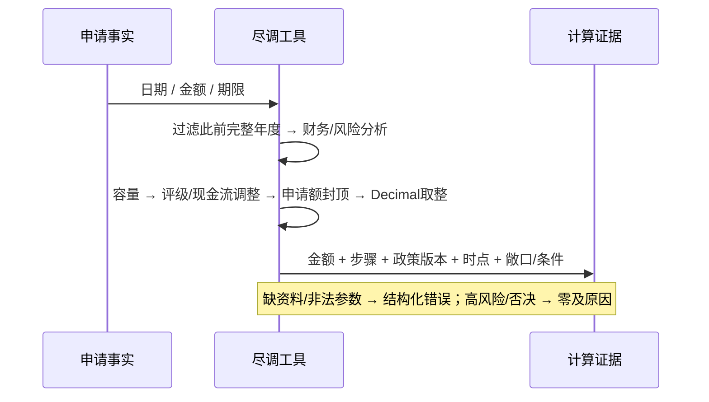

# 信贷金额专项修复 设计

状态：已确认    对应需求：已确认（用户提供改动方案并授权实施）

## 方案概述
按 [额度契约](../../../contracts/dd04-credit-amount.md) 实现本次融资，不按规律 A–D 拟合。
保留营收 0.12、权益 0.40、评级系数、带宽 0.15、步长 100；经营现金流不再乘期限充当硬上限，非正时复用中风险系数作为保守调整，正数时不额外折减。评级和现金流调整作用于财务容量后再按申请额封顶；区间只能在硬上限以下。存量/担保仅作为敞口及条件，逾期/否决仍阻断投放。
所有参与额度运算的原始数值由 `Decimal(str(value))` 转换并校验非有限值；最终整数向下取步长，证据数值在完成计算后才转换为 JSON 数字。
财报按申请年份过滤并排序，额度、评级、反欺诈和独立财报工具一致；没有符合时点的财报时如实报错。企业查询没有贷款时，财报工具仍可分析现有年度，不制造贷款日期。

## 涉及模块与负责人
数据层与工具：`app/tools/dd_calc.py`、`due_diligence.py`；场景与文档：`scenarios/dd04/credit_model.yaml`、本专项；评测：合成 pytest、离线金额对比和实际 runner 复测。不改公共 Agent、前端或评分卡配置。

## 接口 / 契约变更（链接 /contracts）
[额度证据契约](../../../contracts/dd04-credit-amount.md)：证据追加模拟政策、年度、时点、敞口和假设；无 API 顶层变动。

## 数据变更（表、字段、迁移方式）
无表结构/种子/答案变化，无迁移；新增标准库 Decimal 使用，不新增依赖。评测先计算并写出事实结果，再可选加载参考文件评分，两个阶段隔离。

## 红线影响（对照 30-standards/redlines.md 逐条说明）
R1：无模型入口变动。R2：仅代码。R3：步骤与事实证据保留。R4：无题号/企业特化，无失败假结论。R5：标签仅离线评分，无系数搜索。R6：保留高风险确认，不绕过否决。R7：无合规变动。R8：测试后确认前后端。R9：不读取/修改/输出密钥。

## 取舍（选择了什么、放弃了什么、何时重访）
选择可解释的本次融资模拟政策，放弃总授信全额扣存量和经营现金流乘期限硬上限。0.45 来自已有中风险配置，非从某笔参考结果反推；评级与现金流双重保守调整可能偏紧，须独立制度/偿债计划支持才重访，不能用公开答案调松。评级错误（包括严重欺诈否决）本轮不改；参考区间差异保留，不能保证全部吻合。
