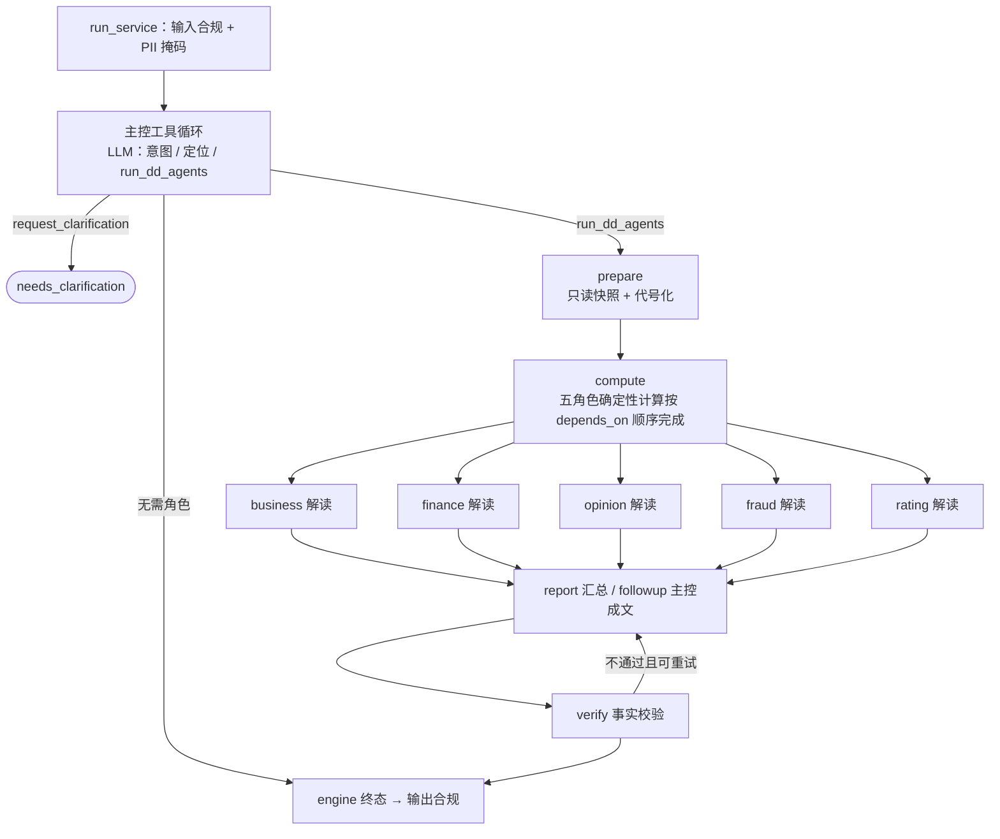

# 赛题 04 多 Agent 编排 设计

状态：已确认    对应需求：已确认

> **本轮变更优先于以下历史方案**：2026-10-24 用户授权最小整改：提问持久化及异步meta隐藏库内已知人名，最终答案/澄清保留自然人代号，仅企业名称可还原；证据API与导出对法人/实控人姓名掩码。发布前数值检查保留正负号，并对可识别科目及明确年度匹配；不变更业务阈值、额度或评级口径。旧版“还原全部名称”的验收仅对企业名称继续有效。

## 方案概述

### 图拓扑

- **落地方式**：未改 `engine.run` 按 `orchestrator` 分派。主控沿用场景工具循环；六角色子图由控制工具 **`run_dd_agents`** 在 handler 内 `invoke`。完整尽调报告经场景「终止工具」机制直接作为答案。
- **拓扑静态**：6 个角色节点始终在图中。不在计划内的角色直接返回 `skipped`。
- **当前并行口径**：`agents.yaml` 默认 `parallel_analysis: true`。`compute` 先按 `depends_on` 顺序把 business、finance、opinion、fraud、rating 的数字全部算完（纯函数，毫秒级），随后五个角色同时调用模型写解读；fraud、rating 只看已经算好的上游结构化事实，不等待上游文字。报告在五个解读完成后开始。设为 `false` 时回到按依赖逐级计算并解读的串行口径。
- **只用 LangGraph 做调度**：模型只经 `app/llm.py`，计算只经 `dd_calc`，不用框架 ChatModel / ToolNode。

### 主控与计划

- 主控可用工具：`get_loan_application`、`find_enterprise`、`request_clarification`、`run_dd_agents(applicationId|enterpriseId, mode: full|followup, roles[], focus?)`、`sql_query`。不设轮数上限，由 token 上限兜底。
- 依赖闭包按 `agents.yaml` 的 `depends_on` 递归补齐。`mode=full` 执行全部 6 个角色。闭包结果推送 `plan_ready`；角色信息主要落在 SSE、`llm_calls.purpose=role:*` 与工具摘要。`contextSnapshot` 已写 `skillsApplied`；契约中的 `plan` / `roles` / `tokens` / `configVersions` **尚未写入 snapshot**（与 tasks 1 一致）。
- 主控未调用 `run_dd_agents` 而直接回答时，不执行角色子图。

### 角色执行模板（`app/agent/dd_roles.py`）

每个角色都按同样三步执行：

1. **计算**：调用对应的 `dd_calc` 函数（`verify_business` / `analyze_financials` / `scan_public_opinion` / `detect_fraud` / `rate_risk` + `calc_credit_limit` / `build_report`），输入是快照和上游角色的 `data`。
2. **分析**（`llm: true` 时）：把代号化后的计算摘要和上游角色的 `analysis` 摘要送给模型，temperature 为 0，`max_tokens` 取该角色的配置值。模型输出 JSON `{analysis, keyFindings[], uncertainties[], needsReview}`，用 Pydantic 校验；失败时把错误回给模型重试 1 次，仍失败则记为 `degraded`。
3. **产出** `RoleResult`，字段包括 role、status（`ok` / `degraded` / `skipped` / `failed`）、data、analysis、待落库的证据、调用审计、usage、errorCode、durationMs。

计算抛出 `ToolError`（例如企业不存在）时，状态记为 `failed`，下游角色依次 `skipped`。

### 快照与代号化（`app/agent/dd_snapshot.py`）

- `prepare` 在主线程里复用 `due_diligence._bundle()`，读出申请和十张表，深拷贝冻结。其中 `enterprise_risk` 只取 `_RISK_FIELDS`（已不含答案列）。
- 代号映射在本地生成：企业全名 → `企业<enterpriseId>`；法人、实控人、股东、关联企业名称按出现顺序编号；统一社会信用代码和证件号直接掩码。映射由 Scenario.build_masker 统一生成，主控与角色共享，只在内存里使用，不落库。
- 用户问题先执行通用 PII 掩码与场景名称处理，再保存到 run、用户消息和会话标题：企业名称保留，库内已知自然人保存为代号。送模型的内容与模型审计预览继续使用代号。最终回答、终止工具报告与澄清问题在输出合规检查前仅还原企业名称，自然人保持代号；信用代码、证件号和地址不还原；代号按边界匹配，未知代号不得匹配已知代号前缀。

### 并发与事务

- 角色函数的签名里不出现 `Session`。只有 `prepare`（读）和收尾（写）两个阶段在主线程里访问 `db`。
- 角色返回待落库的证据。每个 superstep 结束后，主线程按角色固定顺序调用 `persist_evidence`，从而得到稳定的 `ev_` 顺序。
- 并发 emit 在 `dd_graph` 内加锁串行写入记录器（不改 `observability/events.py`）。
- 角色在本地累计 usage 和 llm_calls，汇合时由主线程合并到 `RunOutcome`。

### 运行限制

- 全局：`run_max_tool_rounds` / `run_timeout_seconds` 默认 `None`（不限）；配了数值时原行为照常。LangGraph `recursion_limit` 在不限轮数时取框架兜底。token 上限与 `finish_reason=length` 照常验收。
- 多 Agent：子图由 `run_dd_agents` 调度（无 `Scenario.orchestrator` 分派）。调用前检查剩余 token，并行按 `max_tokens` 预占。场景级上限见 `agents.yaml` 的 `controller.max_total_tokens`。
- 角色级：`agents.yaml` 可配 `timeout_seconds`（报告角色当前 60）；未配置则用全局 `llm_timeout_seconds`。
- 推理开关：`agents.yaml` 的 `roles.*.thinking` 与 `controller.thinking`，经 `llm.complete_with_tools(thinking=)` 下发 DeepSeek 的 `thinking.type`；不配置时不下发参数，沿用接口默认（开启）。当前主控和六个角色全部关闭。
- `llm._request` / `complete_json` 支持 `max_tokens` 与 `timeout`。
- 角色耗时在 SSE `role_finished.durationMs`；`build_timings` 尚未汇总 role 节点。

### 事实校验（`app/agent/dd_verify.py`，纯函数）

逐项检查：带单位数字（允许舍入）、风险档位、规则编号、本次 `ev_` 引用。免责声明「测算建议，非授信审批」由 `check_answer` / 报告角色确定性补为普通段落，**不作拦截项**。

### 终态

复用 `engine._finish_with_answer`。角色计算结果以工具名 `rate_risk` / `calc_credit_limit` / `build_dd_report` 等形式进入 `_tool_data`，供确认规则命中高风险。`needsManualReview` / 确认原因只看：角色 `degraded` 或 `failed`、评分卡要求复核、额度 `creditError`、高风险等；模型自评 `needsReview` 只记 `reviewSuggestedBy`。

## 涉及模块与负责人

| 模块 | 改动 | 负责人 |
|---|---|---|
| `app/agent/`（`dd_graph.py`、`dd_roles.py`、`dd_snapshot.py`、`dd_verify.py` 为新文件；`engine.py`、`scenarios.py`） | 编排、角色、校验、token 预占 | Agent 核心（王小文） |
| `app/llm.py` | `max_tokens` / `timeout` 参数化 | Agent 核心 |
| `app/tools/`（`dd_calc.py`、`due_diligence.py`、`sql_query.py`）、`app/services/catalog.py` | 移除答案列（T0，已完成） | Agent 核心 |
| `scenarios/dd04/agents.yaml`、`scenarios/dd04/prompts/*.md` | 角色、依赖、每角色 max_tokens、提示词 | Agent 核心 |
| `app/agent/dd_graph.py`（emit 锁） | 并行事件串行化 | Agent 核心 |
| `ocft-starter/` | 角色泳道、轨迹按角色分组、新事件类型 | 前端（程柳） |
| `eval/dd04*.py` | 从结构化结果导出六列、双跑一致性 | 评测（彭国） |

## 接口 / 契约变更（链接 /contracts）

以 [contracts/agent-api.md](../../../contracts/agent-api.md) 为准：
- SSE：`plan_ready`、`role_started`、`role_finished`、`verify_finished` 已落地。角色归属主要靠 `llm_calls.purpose=role:*`；事件体可选 `role` 字段未全量写入。
- `contextSnapshot`：**已落地** `skillsApplied`；契约中的 `plan` / `roles` / `tokens` / `configVersions` 仍为待落地（或降级为「仅 SSE + 工具摘要」——确认时二选一）。
- 运行限制：默认不限轮数与总时长。
- `timings` 的 role 节点：设计曾要求，**当前未写入** `build_timings`。
- `errorCode=narrative_check_failed` 已支持。
- 尽调输出与目录已移除外部汇总评级键（T0）。

## 数据变更（表、字段、迁移方式）

无新表、无迁移。角色信息写入现有的 `run_events`、`llm_calls.purpose`、`agent_runs.context_snapshot` 和 `evidence`。`enterprise_risk.risk_level_summary` 列保留在库里，因为导入要保持与原 CSV 一致，但运行时任何代码都不读取它。

## 红线影响（R1–R9）

- **R1 锁定模型**：所有角色调用都经 `app/llm.py`，使用 `deepseek-v4.1-flash`，不新建客户端。
- **R2 代码实现**：LangGraph 只负责调度，角色和校验都是仓库内的代码。
- **R3 证据追溯**：每个角色至少一条证据；报告引用的 `ev_` 由校验器核对。
- **R4 禁止假答案**：数字来自纯函数；校验失败时返回 `narrative_check_failed`，不回填模板结论；`degraded` 如实标注。
- **R5 标签隔离**：运行时不读 `risk_level_summary`（工具、证据、目录、提示词、`sql_query` 全部覆盖，`tests/test_dd_answer_isolation.py` 回归保护）；公开答案只在 `eval/` 中使用。
- **R6 确认留痕**：沿用确认接口；高风险档位、`degraded` 或需复核时进入 `needs_confirmation`。
- **R7 合规**：输入和输出合规不变；校验器复用 `check_output`。
- **R8 本地启动**：零新依赖。
- **R9 密钥**：无影响。

## 取舍（选择了什么、放弃了什么、何时重访）

- **选择静态拓扑加跳过，放弃动态 `Send`**：汇合语义简单，事件可预测。代价是被跳过的节点也会出现在图里，SSE 会推送 `skipped`。
- **选择预取完整快照，放弃角色补查**：并发安全，实现量小。代价是非公开集如果出现快照覆盖不到的数据，就答不出来。重访条件：评测归因显示这类缺失真实存在。
- **选择 6 个角色全部开启模型**：多 Agent 的说服力最强。代价是耗时。重访条件：P90 超过 60 秒时，在配置里关闭三路采集角色的模型。
- **选择关闭推理 + 并行解读，放弃长推理和逐级解读（2026-10-24，目标单笔 ≤30 秒）**：
  - 实测（公开集 10 笔，真实模型）：改前平均 81 秒，报告首调 23–43 秒且常被 8192 上限截断重写；改后单笔 22.5–26.1 秒（1 笔 34.6 秒，原因是主控首轮接口响应 10.9 秒），评级、额度仍 10/10。
  - 代价：反欺诈、评级的解读看不到上游角色的文字判断，只看数字；不推理时模型自算数字的概率可能上升，由事实校验拦截后重写（约 +10 秒）。
  - 重访条件：事实校验重写率明显上升，或解读质量评审不过关时，先对报告单独开启推理，再考虑恢复串行口径。
- **选择结构化字段严格一致，文本只求稳定**：temperature 为 0、章节固定，但不承诺逐字一致。文本差异在测试报告中如实披露。
