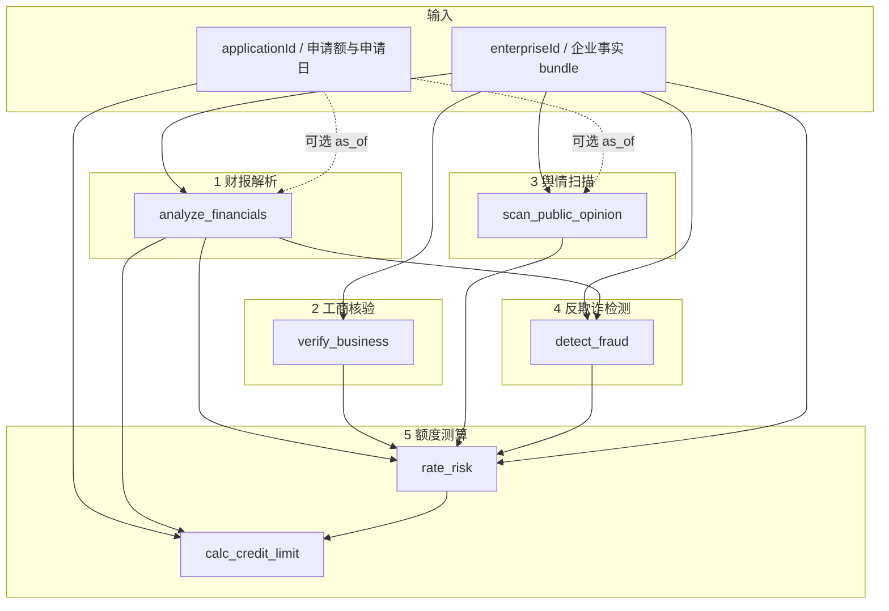

# 尽调五步：依赖关系与单步核对说明

状态：草稿
说明：对照当前代码，供前端单步页与报告版式联调。
对应实现：`ocft-backend/app/tools/due_diligence.py`、`dd_calc.py`  
前端菜单骨架：`ocft-starter/src/lib/report-dims.ts`、`/report/<slug>`

## 1. 菜单目的（产品意图）

顶部「尽调维度」五步菜单**不是**再跑一遍完整对话报告，而是：

1. 选定**企业**（必要时再选定**贷款申请**）；
2. 只执行 / 只展示**当前这一步**的工具结果；
3. 便于人工核对「这一步算得对不对」（规则命中、科目、档位、额度步骤等）。

完整成文与六列导出仍走工作台对话 + `build_dd_report` / 评测导出；单步页与完整报告可并存。

| 步骤 | 菜单名 | 路由 | 主工具 |
|------|--------|------|--------|
| 1 | 财报解析 | `/report/finance` | `analyze_financials` |
| 2 | 工商核验 | `/report/business` | `verify_business_info` |
| 3 | 舆情扫描 | `/report/opinion` | `scan_public_opinion` |
| 4 | 反欺诈检测 | `/report/fraud` | `detect_fraud_signals` |
| 5 | 额度测算 | `/report/credit-risk` | `rate_risk` + `calc_credit_limit` |

## 2. 结论先看：是否独立？

**对调用方（Agent / 前端单步页）**：五步都是**可单独调用的工具入口**，不必先调上一步再调下一步。  
**对计算内核（`dd_calc`）**：后两步会**内部重算**前置结果，存在数据依赖；不是「必须串行调 API」，而是「算第 N 步时会用到第 1–N−1 步同类中间结果」。

| 步骤 | 对外是否可单独跑 | 计算上是否依赖其他步 | 输入最低要求 |
|------|------------------|----------------------|--------------|
| 1 财报解析 | 是 | 否（只读财报表 + 可选申请日） | `enterpriseId` 或 `applicationId`；有申请时用 `apply_date` 截年 |
| 2 工商核验 | 是 | 否（只读企业 bundle） | 同上 |
| 3 舆情扫描 | 是 | 否（舆情 + 涉诉 + 可选 as_of） | 同上 |
| 4 反欺诈检测 | 是 | **是**：内部先跑财报解析（F01–F05）；F06 读关联/担保圈（工商侧事实）；**不读舆情** | 同上 |
| 5 额度测算 | 部分 | **是**：评级吃 1–4；额度还吃申请额与评级 | 见下节 |

第 5 步拆开看：

- **风险评级** `rate_risk`：可只给 `enterpriseId`（无申请时用空壳申请跑管线取 `rating`）；内部等价 `_pipeline` 的前半，依赖财报解析 / 工商核验 / 舆情扫描 / 反欺诈检测中间结果。
- **建议额度** `calc_credit_limit`：**必须** `applicationId`（申请额、期限、担保方式、申请日）；内部再跑完整 `_pipeline` 取 `credit`。

因此单步核对页的输入建议：

- 步骤 1–4：**企业编号即可**；有申请时附带申请编号，财务/舆情时点更准。
- 步骤 5：**必须能选到一笔申请**（或企业下默认最近一笔申请），否则只能核对评级、不能核对额度。

## 3. 依赖关系（计算向）



虚线：有申请时影响时点截取；无申请时工具仍可跑，但财报年度与舆情衰减可能与「按某笔申请尽调」不一致。

完整尽调管线 `_pipeline`（`due_diligence.py`）顺序固定为：

1. `analyze_financials`
2. `verify_business`
3. `scan_public_opinion`
4. `detect_fraud`（吃 finance）
5. `rate_risk`（吃 finance + business + opinion + fraud）
6. `calc_credit_limit`（吃 application + finance + rating）
7. `build_report`（汇总，非本菜单五步之一）

菜单顺序（财报解析 → 工商核验 → 舆情扫描 → 反欺诈检测 → 额度测算）与完整尽调的业务叙事一致；各工具仍按自身依赖重算所需中间结果，不读取上一次页面结果，也不改变 Agent 编排拓扑。

## 4. 各步读什么、产出什么（核对焦点）

### 1 · 财报解析

- 数据：`enterprise_finance`；若有申请则只用 `apply_date` 之前的完整年度。
- 配置：`metrics.yaml`。
- 核对：近三年科目、比率、勾稽、`growth`。
- **不依赖**工商/舆情/反欺诈检测；缺财务行时如实空结果，不得编造正数额度（额度步另验）。

### 2 · 工商核验

- 数据：`enterprise_basic`、股东、关联、担保、风险表中与工商相关的字段。
- 配置：`scenarios/dd04/scorecard.yaml`（部分工商阈值）。
- 核对：经营状态、失信/限高、实缴比例、实控人与大股东、担保逾期/担保圈等 `findings`。
- **不依赖**财务、舆情、反欺诈检测结果。

### 3 · 舆情扫描

- 数据：`enterprise_public_opinion`、`enterprise_lawsuit`。
- 配置：`opinion.yaml`；申请日作衰减 as_of。
- 核对：事件列表、标签、舆情分、未结被告金额等。
- **不依赖**财务/工商/反欺诈检测计算结果（涉诉与舆情是原始表）。

### 4 · 反欺诈检测

- 数据：企业 bundle + **内部即时** `analyze_financials` 的 growth/科目。
- 配置：`fraud_rules.yaml`。
- 核对：规则编号、命中值、阈值、置信度；无命中须如实展示。
- **依赖财报解析逻辑**（同进程内重算，不要求用户先打开「财报解析」页）。

### 5 · 额度测算

- **评级**：评分卡维度分来自财务指标 flag、工商 findings、舆情健康分、反欺诈检测命中等；一票否决可读失信/限高/逾期/严重欺诈；`externalRiskLevel` 只对照不计分。
- **额度**：必须申请；吃评级档位、财报能力、申请额封顶与政策版本；高风险或否决时额度 0。
- 配置：`scorecard.yaml`、`credit_model.yaml`。
- 核对：档位与分、vetoes、额度 `steps`、风控条件；与外部汇总是否一致只作提示。

## 5. 交互设计（已按此落地）

目标：**任意点开一步，只看这一步的真实工具结果**；不必先跑工作台对话，也不必按 1→5 点完。

### 5.1 页面结构

```
顶栏上层：Logo / 系统信息 / 身份
顶栏下层：工作区（智能尽调·企业档案·尽调报告） | 尽调五步（1.财报解析 … 5.额度测算）

本步页：
  ┌ 标题：步骤 N · 维度名 + 工具名 ─────────────────────┐
  ├ 分析对象：企业下拉搜索  [分析本步]                    │
  └ 本步结果：仅当前工具 data（失败/跳过如实展示）        │
```

### 5.2 操作路径

1. 点顶栏某一维（如「3.舆情扫描」）→ 进入 `/report/opinion`。
2. **下拉搜索并选择企业**（编号/名称）；无需再填申请编号。
3. 选中后即分析本步（也可点「分析本步」）→ `POST /api/agent/dd/steps` → 下方只渲染本步结果。
4. 额度步由服务端自动取该企业**最近一笔申请**；结果区会回显所用 `applicationId`。
5. 再点顶栏另一维 → URL 保留 `?enterpriseId=`，**自动重跑新维度**。
6. 结果区按工具字段结构化展示（表格 / 指标卡）；底部可展开原始 JSON 联调。

### 5.3 URL 约定

| 示例 | 含义 |
|------|------|
| `/report/finance` | 财报解析，尚未指定对象 |
| `/report/business?enterpriseId=E001` | 工商核验，已锁定企业 |
| `/report/credit-risk?enterpriseId=E001` | 额度测算；申请由后端解析 |

### 5.4 与工作台分工

| | 工作台 `/` | 单步页 `/report/*` |
|--|-----------|-------------------|
| 目的 | 完整对话尽调、轨迹、证据、导出 | 抽检单维工具是否算对 |
| 是否调模型 | 是 | **否** |
| 输入 | 自然语言 / 点选编号填问句 | 企业 / 申请表单 |
| 结果范围 | Agent 成文 + 多工具 | **仅当前 step 的工具** |

### 5.5 接口

见契约 [`contracts/agent-api.md`](../../../contracts/agent-api.md) → `POST /api/agent/dd/steps`。  
实现：`app/services/dd_step.py`；前端：`api.ddStep` + `DimensionPage`。

## 6. 常见误解

| 误解 | 实际 |
|------|------|
| 五步必须串行调工具，少一步后面会失败 | 各工具入口可单独调；后步内部会重算所需前置 |
| 单步页之间会共享上一步缓存 | 每次按库内事实重算；页间只共享 URL 里的企业/申请 |
| 只输入企业就能核额度 | 额度工具强制 `applicationId`；无申请时评级仍可出 |
| 单步页会写死样例结论 | 禁止；只展示实时工具结果 |
| 外部 `risk_level_summary` 是本系统第 5 步结论 | 仅对照字段，不参与加权 |

## 7. 变更时怎么改本文

- 改 `dd_calc` 某步入参 / 是否内嵌重算前置 → 更新第 2、3、4 节。
- 改工具对外参数 → 更新第 2 节与契约 `dd/steps`。
- 换报告版式 → 只改 `DimensionPage` 结果区，保留输入条与 `ddStep` 调用。
