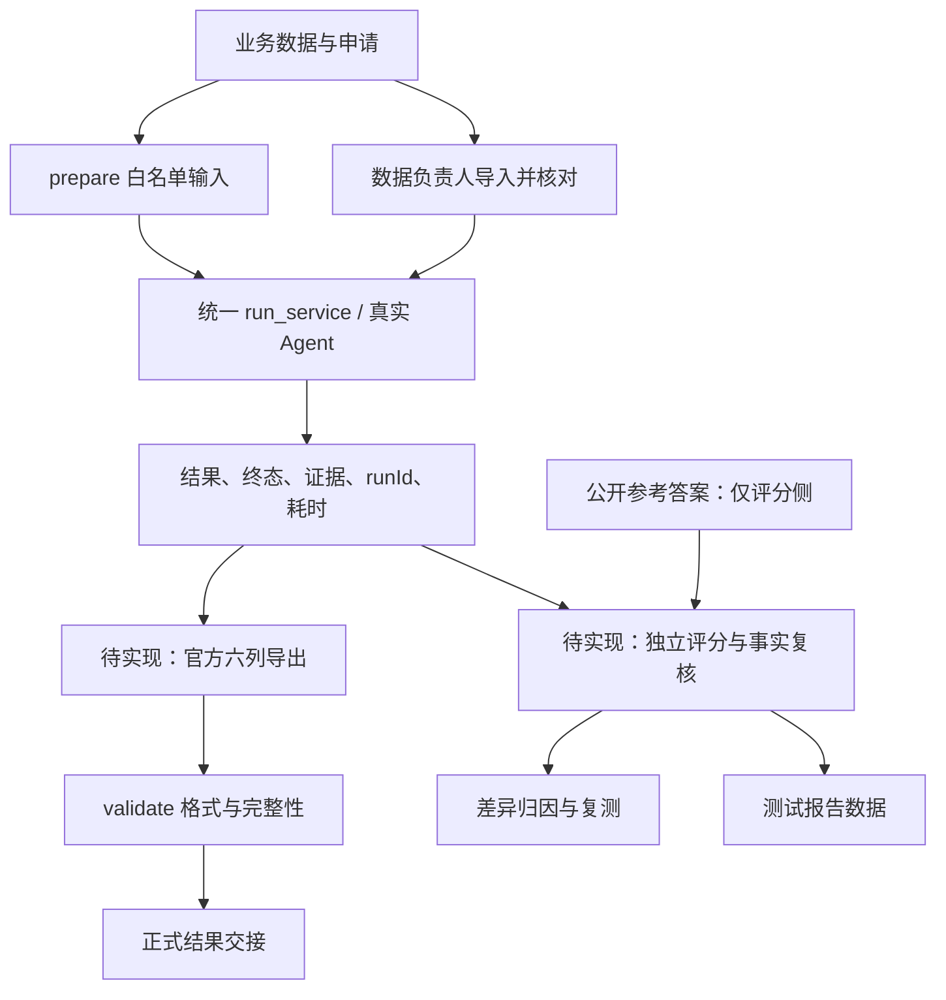

# 赛题 04 · 评测与答题工作手册

> 更新日期：2026-10-24。代码核对基线：`0bb8646`。
> 状态：职责与执行清单已梳理；本题真实模型评测、官方业务导出尚未验收。
> 使用人：本次接手“评测与答题”的负责人。原[模块分工表](../../10-strategy/模块分工表.md)仍登记程柳，本文件不替代团队成员分工确认。
> 本文是工作说明与操作清单，不是已完成的测试报告，也不代替接口契约或功能 spec。

> 后续实测：2026-10-24 已更新至 `cfa4d33`，注册场景 `enterprise_dd` 并跑完公开10笔申请、10问及6道场景样例；环境退出139已定位到readline扩展，禁用测试进程中的该扩展后全量259 passed、1 skipped。详见[首轮实测报告](../../../测试数据/评测/2026-10-24/dd04-baseline/公开评测报告.md)。下文现状及未完成项为旧基线快照，当前结果、导出边界及缺陷以实测报告为准。

## 1. 先明确你最终要交什么

你负责把“系统能处理一笔申请”推进到“整批题目可运行、结果可核对、问题可追溯、文件可提交”。

| 交付物 | 内容 | 验收方式 | 交给谁 |
|---|---|---|---|
| 公开集结果 CSV | 10 笔申请，官方六列，系统真实生成 | 编号齐全，格式校验通过，逐条业务复核 | 合规与提交包负责人 |
| 非公开集结果 CSV | 现场新样本，同结构输出 | 与现场输入一一对应，保留起止时间及运行记录 | 合规与提交包负责人 |
| 公开集逐条比对表 | 评级、额度、结论、评分要点及 runId | 每笔可追溯；失败和未完成保留在分母 | 测试报告负责人 |
| 自然语言问询记录 | 10 个公开问题的答复、证据、覆盖情况 | 完成与正确分别统计，事实人工复核 | 测试报告负责人 |
| 缺陷与复测记录 | 错误现象、依据、归属、修复版本、复测结果 | 开发能据此复现，修复后有新结果 | 对应开发负责人 |
| 耗时与批次记录 | 完成数、失败数、总耗时、平均、P50/P95、最大值 | 明确样本范围、计时口径、代码和配置版本 | 测试报告负责人 |
| 批量命令与原始记录 | 输入准备、运行、导出、校验的命令及日志 | 另一人能照命令重复执行 | README 与提交包负责人 |

官方依据：[赛题说明](../../00-rules/赛题/赛题04_企业智能信贷尽调/题目说明.md)、[提交材料说明](../../00-rules/赛题/赛题04_企业智能信贷尽调/提交材料说明.md)第 2.5、2.7、3.2 节。优先以实际数据文件为基准；提交说明里的示例成绩和示例业务值不能抄成实测结果。

## 2. 职责边界与协作方式

### 2.1 你独立推进的工作

- 维护 `ocft-backend/eval/` 中的输入准备、批量运行、评分与导出适配。
- 维护每轮评测输入、输出、日志、版本记录与问题单。
- 在评分侧读取公开参考答案，设计可解释的比对口径。
- 复核结果完整性和业务差异；推动开发修复后重新评测。
- 协调非公开集接收、数据导入、现场批量运行和结果交接。

### 2.2 需要其他模块提供的东西

| 协作方 | 需要提供 | 你验收什么 | 发现问题交回什么 |
|---|---|---|---|
| 黎锦涛：Agent 核心 | 已注册场景 ID、统一服务入口、结构化结果位置、终态与错误含义、追问方式 | 一笔申请可执行，结果与证据可按 runId 查询 | 输入、场景、runId、终态、缺失字段、错误日志 |
| 王小文：数据与工具 | 新样本导入命令、导入数量、字段单位、财务年份、规则及配置版本 | 原始数据可查询，工具数值有来源，额度和评级有依据 | 原始字段与工具结果差异、单位/年份/规则编号 |
| 陈修活：合规与提交 | 最终命名、脱敏要求、打包路径和截止节点 | 两份 CSV 可纳入包，日志无凭据，输出脱敏 | 文件路径、编码校验、完整性及未完成清单 |
| 文档与测试报告负责人 | 报告结构、最终团队名、材料定稿节点 | 指标与原始结果一致，未测项明确标注 | 比对表、耗时表、问题单、复测结论 |
| 胡乾豪：截图与演示 | 需要演示的真实操作路径 | 截图/视频与当前版本实际结果一致 | 可复现申请、操作步骤与 runId |

不在本次评测工作中直接修改公共编排、数据库模型、业务工具或前端。发现这些模块的问题先提交证据给归属人；跨模块修改按 `AGENTS.md` 及契约流程执行。此处的协作清单不代表已联系或通知任何成员。

## 3. 当前已有实现和缺口

以下“已有”表示在核对基线中存在对应代码，不表示本题真实业务链路已经验收。

| 能力 | 代码/文档 | 当前能做 | 还不能据此证明什么 |
|---|---|---|---|
| 数据体检 | `eval/dd04_data.py` | 业务表白名单检查、结构/关联/数字日期/三年与勾稽检查 | 不等于已导入数据库或业务口径正确 |
| 输入准备 | `eval/dd04.py:prepare_inputs` | 申请与问询转 JSONL，只保留输入白名单 | 不验证指定场景已存在，不调用 Agent |
| 通用题目加载 | `eval/dataset.py` | JSONL/JSON/CSV/XLSX 及目录输入，分离 expected | 不应直接拿带参考答案的原始问询表当运行入口 |
| 通用批量答题 | `eval/run.py:run_item/evaluate` | 统一服务入口、多轮、逐题落盘、单题失败隔离 | 尚未接通赛题 04 专属业务输出 |
| 运行记录 | `results.jsonl` | 终态、答案、runId、工具、证据摘要、Token、耗时 | 摘要不是完整证据，仍需 runId 追溯 |
| 通用评分 | `eval/scoring.py` | 终态、关键词、工具与证据存在性检查 | 不能代表本题评级、额度和事实正确率 |
| 通用导出 | `eval/table_export.py` 与 `run.py` | 通用 CSV/XLSX、answers.json | 不是官方六列业务结果 |
| 官方格式校验 | `eval/dd04.py:validate_results` | BOM、六列顺序、编号完整性、企业对应、非空 | 不检查评级、额度和结论业务正确性 |
| 报告骨架 | `submission/dd04/测试报告.md` | 已有版本、逐条比对、问询、归因与耗时空表 | 未填真实模型成绩 |

当前明确缺口：

1. `app/agent/scenarios.py` 尚未注册本题企业信贷尽调场景；原 `credit_review` 是旧场景。
2. `eval/run.py` 的 `EXPORTERS` 只有 `default`，没有官方六列适配器。
3. 当前评测结果行没有已约定的本题结构化评级、额度、结论字段；需要核心模块提供结果契约。
4. 没有本题公开答案逐条对比、问询事实覆盖的专用评分实现。
5. 汇总已有平均单题耗时；批次墙钟耗时、P50/P95、最大值及超目标统计待补。
6. 断点续跑按题目 ID 复用旧结果，尚未校验输入、代码、配置版本是否变化。

本次对话曾尝试运行 `tests/test_eval.py` 与 `tests/test_dd04_preparation.py`，虚拟环境进程退出码为 `139`，没有测试结果。原因未定位，不能写成“本次测试通过”。历史准备验证见[准备验证记录](../../10-strategy/赛题04准备验证.md)，历史记录与当前验证分开使用。

## 4. 两条工作链路



公开集：有参考答案，运行后评分。非公开集：只含输入，运行、复核完整性和证据、统计耗时；没有标准答案时不报告正确率。

`question_public.csv` 同时包含问题和 `reference_answer`。现有 `prepare` 会打开原表解析数据，再仅取输入白名单生成 JSONL；它不是“完全不打开含答案的文件”，关键保证是参考答案不进入运行请求、Prompt、工具或会话。

## 5. 开始实现前必须对齐的结果契约

以下为评测侧需要确认的事项，不是已生效的 API 字段设计。正式字段和结构由 Agent 核心先登记到 [`contracts/agent-api.md`](../../../contracts/agent-api.md)，本文不建立第二份接口契约。

| 待对齐项 | 必须回答的问题 | 未对齐的影响 |
|---|---|---|
| 场景 ID | 实际注册 ID 是什么？申请与单项问询是否同一入口？ | 可能误跑旧场景 |
| 输出位置 | 结构化业务结果通过哪个现有/新增服务字段获得？ | 评测无法稳定导出 |
| 编号映射 | 申请、企业和运行记录如何一一对应？ | 可能串题或漏题 |
| 风险评级 | 枚举、缺失值、需人工复核时如何表示？ | 评级比对口径不一致 |
| 额度 | 金额单位、单值/区间、拒贷/极小额度如何表示？ | 可能相差万倍或误判区间 |
| 结论与要点 | 哪些由业务工具提供，哪些由模型成文？依据在哪里？ | 容易把自述当正确性证明 |
| 证据 | 哪些证据支持评级、额度和关键判断？ | 有文本但无法核实 |
| 终态 | 哪些终态允许导出建议，哪些必须保留为未完成？ | 把需确认/失败误报为成功 |
| 新数据导入 | 入口、参数、幂等/追加行为及核对方式？ | 非公开样本无法及时运行 |
| 配置与时点 | 评分卡、规则、财务年份及申请时点版本是什么？ | 同一笔数据算出不同结果 |

现有 runner 只保存最后一轮的终态和答案，多轮耗时及用量累加。需要逐轮评价的问询必须结合各轮 runId 查完整运行记录，不能只看最后一轮答复。

## 6. 评分口径：怎么算，哪些不能算

本节是内部自测建议口径；不自行设定官方权重或推算总分。存在歧义时记录待确认，按官方要求修订。

### 6.1 完成率、正确率分开

设总输入数为 N；公开集当前 N=10，非公开集以实际收到的数量为准。

- 运行完成率：达到已约定完成终态的申请数 / N。
- 评级一致率：评级与标准一致的申请数 / N。
- 额度完全一致率：额度与标准完全一致的申请数 / N。
- 失败、空结果、未完成均保留在申请级分母；另列原因。
- `needs_confirmation` 等状态单独统计，是否可交付按契约约定，不自动算最终成功。
- 无参考答案时，正确率写“不可计算”，不以调用成功率代替。

### 6.2 风险评级

仅做不改变含义的格式规范化，例如去除首尾空白。禁止为了提分把“中高风险”自动改成“中风险”。未认识的枚举列为异常，保留原值。

每笔记录：申请编号、企业编号、系统评级、标准评级、是否一致、依据、runId。

### 6.3 建议授信额度

先统一金额单位，再处理金额表达。保留原始文本，解析结果另存评分记录，不能回写业务答案。

| 情况 | 处理原则 |
|---|---|
| 两个数值区间 | 端点相同才算完全一致；重叠单独报告 |
| 单值与区间 | 单值落入标准区间可记“区间内”，不能冒充区间完全一致 |
| 拒贷、0、极小额度等 | 先确认语义映射；存在歧义则人工复核，不擅自统一为 0 |
| 无法解析或缺失单位 | 标记待复核/解析失败，不填默认额度 |
| 精度差异 | 容差及依据事先确认，不根据本轮分数调整 |

区间重叠的辅助条件为 `max(系统下限, 标准下限) <= min(系统上限, 标准上限)`；这只说明相交，不说明额度合理。拒贷结论却给出正额度等矛盾，应单独报错。

### 6.4 尽调结论与评分要点

要点逐个记录“已覆盖且事实正确 / 缺失 / 事实错误 / 与结论矛盾 / 待人工复核”，并附系统原文位置与证据。

- 不能仅因出现“现金流”“担保圈”等词就算识别正确。
- 核对企业、年份、金额、单位、比率和风险方向。
- 数值应来自工具与原始事实；不得从标准答案回填。
- `scoring_points` 是系统自评说明，不能直接当作独立评分结果。
- 覆盖率分母取标准要点总数；未复核要点列出数量，不当作通过。
- 自动关键词检查可筛出候选，最终正确覆盖需要事实验证；不额外接入评分模型。

### 6.5 自然语言问询

对 10 个公开问题逐条记录：问题编号、企业编号、运行终态、答复、runId、参考要点、已验证覆盖项、错误及遗漏。

分别报告“已处理问题数 / 10”和“事实及要点复核通过问题数 / 10”。多轮指代、追问补充与需要澄清可作为额外场景测试，单独列数量，不混入公开 10 问的分母。

### 6.6 时效与一致性

- 单题：现有 `durationMs` 包含该题服务调用、多轮、轨迹与证据查询的耗时，不是纯模型耗时。
- 批次：另记整批开始至最终导出校验结束的墙钟耗时；数据导入耗时单独记。
- 平均、P50、P95、最大值、超过 30 秒数同时给出；注明统计算法与是否含失败。
- 全部已执行尝试与成功题耗时分别统计；失败和重试不能静默删掉。
- 断点续跑跨多次执行时，分别保留每次起止时间，不把单次命令耗时冒充整批处理耗时。
- 30 秒是团队目标，不是已核实的官方硬性时限。
- 同企业、同输入、同配置运行两次，比较评级、额度、关键事实、报告结构，并保留原文 diff；提交要求涉及完整结论一致性，不能只检查字段就声称全文一致。

## 7. 详细任务清单与验收

以下顺序按依赖安排，不虚构完成日期。原分工表中的赛时节点仍由团队协调。

| ID | 优先级 | 要做的事 | 依赖 | 完成标准 |
|---|---|---|---|---|
| E01 | P0 | 确认运行环境与评测测试可执行 | 可用 Python 与项目依赖 | 记录解释器、命令、测试结果；定位此前退出 139 的原因 |
| E02 | P0 | 对齐第 5 节结果契约 | 核心、数据负责人 | 实际场景、字段路径、单位、终态、导入命令可查 |
| E03 | P0 | 数据体检并准备两类输入 | 当前数据包、实际场景 ID | 申请与问询各 10 条，输出不含参考答案字段 |
| E04 | P0 | 跑通单笔真实申请 | 场景与业务数据已就绪 | 真实结果、证据、runId、耗时完整，无字段猜测 |
| E05 | P0 | 实现官方六列导出 | E02、E04 | 成功结果映射清楚；编号/编码/顺序正确；失败清单独立保留 |
| E06 | P0 | 实现公开集比对 | E05、评分侧参考答案 | 逐笔评级、额度、结论与要点可追溯；失败计入分母 |
| E07 | P0 | 完整运行公开 10 笔 | E05、E06 | 全部有记录；格式校验结果与差异表保存 |
| E08 | P0 | 完整运行公开 10 问 | 问询入口可用 | 每问有答复/错误、覆盖判定及证据复核 |
| E09 | P0 | 问题归因与复测 | E07、E08 | 缺陷归属清楚，修复版本与新批次结果关联 |
| E10 | P1 | 补齐耗时统计及重复一致性 | 真实运行记录 | 指标口径固定，原始值和两轮差异可复核 |
| E11 | P0 | 演练现场新样本导入与运行 | 数据负责人、E05 | 使用合成或合规测试输入演练，另一人能按命令完成 |
| E12 | P0 | 非公开集正式运行及交接 | 现场实际数据 | 无漏题、失败清楚、结果校验通过或明确报告未完成，不报无依据正确率 |
| E13 | P0 | 提供报告数据与正式文件 | E07–E12 | 结果、报告数据、日志版本相符，提交方确认收到 |

P0 为本模块交付阻塞事项，P1 为应补充的分析验证，不表示官方问题等级。

业务代码接入时按仓库 spec 和 Skill 流程推进；本次只生成文档，不把以上待办标记为实现完成。

## 8. 当前可用命令与执行前提

### 8.1 环境与离线测试

从仓库根目录进入后端；下方 `python` 必须指向项目依赖已安装的解释器。

```bash
cd /Users/dawn/ai马拉松/ocft-backend
python --version
python -m pytest tests/test_eval.py tests/test_dd04_preparation.py -q
```

Windows 使用项目虚拟环境对应的 Python；不要复制 macOS 绝对路径。当前环境退出 139 的问题尚未修复，命令列在这里不代表已验证通过。

### 8.2 数据体检

```bash
python -m eval.dd04_data \
  --data-dir ../docs/00-rules/赛题/赛题04_企业智能信贷尽调/data \
  --output-dir eval/output/dd04-round-001/audit
```

检查 `data-audit.json` 与 `data-audit.md`。error 阻断后续；warning 逐条判断。实物是 9 张业务表，另有关系、问询和答案文件；不因说明写“10 张表”自行补造数据。

### 8.3 生成无参考答案的运行输入

先由核心负责人确认实际场景 ID，再设置变量。若仍为空，下面的 shell 检查会报错，不能继续。

```bash
DD04_SCENARIO_ID=''
: "${DD04_SCENARIO_ID:?请先填写已注册并验证的赛题04场景ID}"

python -m eval.dd04 prepare \
  --input ../docs/00-rules/赛题/赛题04_企业智能信贷尽调/data/loan_application.csv \
  --kind applications \
  --scenario-id "$DD04_SCENARIO_ID" \
  --output eval/output/dd04-round-001/inputs/applications.jsonl

python -m eval.dd04 prepare \
  --input ../docs/00-rules/赛题/赛题04_企业智能信贷尽调/data/question_public.csv \
  --kind questions \
  --scenario-id "$DD04_SCENARIO_ID" \
  --output eval/output/dd04-round-001/inputs/questions.jsonl
```

申请只取 `application_id`、`enterprise_id`；问询只取 `question_id`、`enterprise_id`、`question`。输出只有 `id`、`question`、`scenarioId`。

### 8.4 跑一题，再跑整批

**以下会调用真实模型、产生费用及数据库运行记录。前提是场景、数据、凭据及合规链路已由负责人确认。本文未执行这些命令。**

```bash
python -m eval.run \
  --input eval/output/dd04-round-001/inputs/applications.jsonl \
  --output-dir eval/output/dd04-round-001/smoke \
  --fresh --limit 1

python -m eval.run \
  --input eval/output/dd04-round-001/inputs/applications.jsonl \
  --output-dir eval/output/dd04-round-001/applications \
  --fresh

python -m eval.run \
  --input eval/output/dd04-round-001/inputs/questions.jsonl \
  --output-dir eval/output/dd04-round-001/questions \
  --fresh
```

每轮使用新目录，例如 `dd04-round-002`，不要覆盖已交接结果。当前 runner 按 ID 跳过所有已有行，失败行也会跳过；故障后若需重跑失败题，当前可用方式是准备失败题输入并用新输出目录重新运行，保留原批次。不要默认“续跑”等于“自动重试失败”。

输入由 `prepare` 生成时不含 `expected`，因此通用 `summary.json` 的 `accuracy` 为空是正常行为；本题业务评分需另行接入。

### 8.5 官方导出与校验

**官方业务导出和专用比对命令尚未实现，此处不编造命令。** 接入后由评测负责人补充已实际验证的完整用法。

下方仅校验已经生成的真实结果文件；路径为约定示例，文件需先由待实现的官方导出产生。

```bash
python -m eval.dd04 validate \
  --applications ../docs/00-rules/赛题/赛题04_企业智能信贷尽调/data/loan_application.csv \
  --results eval/output/dd04-round-001/official-results.csv
```

退出码 0 表示格式与完整性通过，1 表示失败。评级和额度是否正确仍需评分侧检查。

## 9. 输出目录与版本记录

建议每轮目录如下。标注“待实现”的文件不是现有 runner 自动产出。

```text
eval/output/dd04-round-001/
  inputs/                    # prepare 生成
  audit/                     # dd04_data 生成
  smoke/                     # 单笔 runner 输出
  applications/              # 整批 runner 输出
    results.jsonl
    summary.json
    answers.json
    results.csv
    results.xlsx
  questions/                 # 问询 runner 输出
  official-results.csv       # 待实现：官方导出
  comparison.csv             # 待实现：独立业务比对
  question-review.csv        # 待实现：问询复核
  batch-record.md            # 先人工记录
  issues.md                  # 先人工记录
```

`batch-record.md` 至少填写：批次编号、执行人、北京时间起止、代码 SHA/分支/工作区差异、Python/依赖版本、场景 ID、规则与配置版本/哈希、输入文件清单及哈希、模型身份、运行命令、题目数、失败与重试、输出路径。不得记录密钥、主密钥或真实连接串。

`eval/output/` 默认被 Git 忽略，不能把“本地已有文件”等同于“提交包已有文件”。封包前将最终两份 CSV 与需要的报告材料交到实际提交目录，原始记录保留在受控位置。

## 10. 缺陷记录模板与定位顺序

```text
问题编号：EVAL-xxx
批次/代码版本/配置版本：
申请或问题编号/企业编号：
输入与场景 ID：
实际终态、runId、错误码：
系统评级、额度、结论：
参考结果及来源（仅评分侧）：
差异与影响：
证据：工具名、规则编号、来源记录、日志位置
归属负责人：
修复版本：
复测批次与结果：
```

| 现象 | 先查什么 | 通常归属 |
|---|---|---|
| 找不到企业/申请 | 原始编号、导入数量、表关联、工具查询 | 数据与工具 |
| 财务指标错误 | 年份、金额单位、公式和缺失字段处理 | 数据与工具 |
| 评级/额度差异 | 规则命中、评分卡、额度参数和配置版本 | 数据与工具；编排漏调用再交核心 |
| 工具有正确结果但答复矛盾 | 工具轨迹、模型答复、结果映射 | Agent 核心 |
| 没调用必要工具、无证据或指代错误 | 场景白名单、编排、会话与终态 | Agent 核心 |
| CSV 漏行、错列、乱码 | 结果映射、编号关联、编码与导出异常 | 评测 |
| 正确业务结果却被判错 | 解析单位、区间规则、关键词误判、分母 | 评测 |
| 超时、限流或凭据不可用 | 错误码、调用耗时、重试和服务日志 | 核心/环境负责人，评测保留失败记录 |
| 外送或导出未脱敏 | 实际请求/证据导出、脱敏链路 | 合规与对应实现方 |

按“数据 → 工具 → 编排 → 成文 → 评分 → 导出”检查，不把所有不一致归为模型问题。修复针对通用原因，不针对题号写分支或把标准答案塞回运行链路。

## 11. 非公开集现场操作顺序

1. **接收**：记录收到时间、文件清单、数量与哈希；确认给的是新申请表还是整套业务表，保留原件。
2. **体检**：整套数据可用现有体检；若只收到增量表，由数据负责人确认与现有库的关联，不强行用缺表体检当成不合格。
3. **导入**：由数据负责人使用已验收入口执行，核对新增编号、行数、重复及关联；评测不私自改库补数据。
4. **准备**：只从实际输入构造白名单 JSONL，固定场景、代码与配置版本。
5. **执行**：新批次目录，完整保留 stdout/stderr、每题 runId、起止时间与错误。
6. **复核**：确认总数、终态、证据及编号；失败原因单列。重跑保留原记录并注明最终采用哪一次结果。
7. **导出**：使用已验收官方适配器；按收到的申请表校验，不拿公开表替代。
8. **交接**：结果 CSV、完成/失败数、耗时、未解决项与版本记录一起交给提交负责人。

没有标准答案时不编造一致率。若仍有失败，官方 CSV 的完整性校验可能不能通过，必须标记“未满足完整交付”；由提交负责人核对主办方接受的失败表示方式，不能填默认评级、额度或假结论使其通过。

## 12. 最终交付验收清单

- [ ] 实际场景 ID 已确认，未误跑旧场景。
- [ ] 参考答案/expected 未进入运行请求、Prompt、工具与会话。
- [ ] 公开 10 笔申请均有原始运行记录，编号与企业对应正确。
- [ ] 官方 CSV 六列及顺序准确，使用 `utf-8-sig`，无重复、遗漏和空业务字段。
- [ ] CSV 校验通过；校验输出作为证据留存。
- [ ] 逐条评级、额度、结论与要点已复核，分母包含失败与未完成。
- [ ] 额度完全一致、落入区间与区间重叠分开报告。
- [ ] 自然语言 10 问的完成与事实覆盖分别统计。
- [ ] 无证据结论、矛盾结论、需确认状态有明确处理记录。
- [ ] 耗时口径与统计范围明确，30 秒未写成官方硬性时限。
- [ ] 重复运行一致性检查有原始结果和差异证据。
- [ ] 非公开集有接收、导入、执行、导出与交接记录。
- [ ] 新版本重新运行未误用旧缓存，重试和最终采用记录可追踪。
- [ ] 两份结果按最终团队名放入 `系统输出/`；示例名“星火队”不直接视为最终队名。
- [ ] 测试报告 PDF 与同名 MD 的指标一致，A4、PDF≤30MB；未测项如实保留。
- [ ] 输出、日志及报告无凭据，敏感字段按要求脱敏。
- [ ] 另一人按 README 命令完成过运行演练；最终文件已由提交负责人确认接收。

## 13. 接手后先做的三件事

1. 向核心与数据负责人确认第 5 节的结果契约，优先拿到场景 ID、结构化结果来源、额度单位和导入命令。
2. 确认本机解释器可运行现有评测测试，再准备申请/问询输入；依赖未就绪时先整理比对表与问题单。
3. 业务链路就绪后先跑一笔真实申请，接通六列导出与校验，再跑整批、评分和复测。

## 14. 依据与维护入口

- 规则：[AGENTS.md](../../../AGENTS.md)、[红线](../../30-standards/redlines.md)。
- 官方要求：[题目说明](../../00-rules/赛题/赛题04_企业智能信贷尽调/题目说明.md)、[提交材料说明](../../00-rules/赛题/赛题04_企业智能信贷尽调/提交材料说明.md)。
- 团队协作：[模块分工表](../../10-strategy/模块分工表.md)、[企业信贷尽调 Spec](../../40-specs/enterprise-dd/requirements.md)、[多 Agent 编排 Spec](../../40-specs/dd-multi-agent/requirements.md)。
- 当前实现：[eval README](../../../ocft-backend/eval/README.md)、[runner](../../../ocft-backend/eval/run.py)、[评分](../../../ocft-backend/eval/scoring.py)、[准备与校验](../../../ocft-backend/eval/dd04.py)、[场景注册](../../../ocft-backend/app/agent/scenarios.py)。
- 操作及验收：[准备工具手册](../../50-runbooks/赛题04准备工具.md)、[测试报告骨架](../../../submission/dd04/测试报告.md)、[交付清单](../../10-strategy/赛题04交付清单.md)。

每次接通业务入口、导出或评分后，更新第 3 节现状、第 7 节任务和第 8 节真实命令，同时更新开发流程与开发日志；不能仅因文档完成就把正式评测标记为完成。
